# Veyra

**Industrial machine vision and AI inspection.** One desktop platform for the whole path from a camera image to a
traceable inspection result: configure stations and cameras, build inspections from classical vision tools and AI
models, label data and train Ultralytics and Anomalib models, validate and release through approval, run on the line,
and investigate every result with its evidence.


> **About this repository.** Veyra is a commercial industrial machine-vision and AI inspection product, developed
> since 2022 and continuously maintained and updated. This public repository is a curated presentation of it: the
> product's documentation, screenshots of the real application, its verification record, release notes and
> third-party notices. It contains **no source code, model weights, datasets or customer data**; the complete project
> is kept in a private repository. Veyra's desktop studio is built on [FluentQt](https://github.com/pntrungbk15/fluentqt-showcase) Community and FluentQt Pro, which are not
> publicly available either.

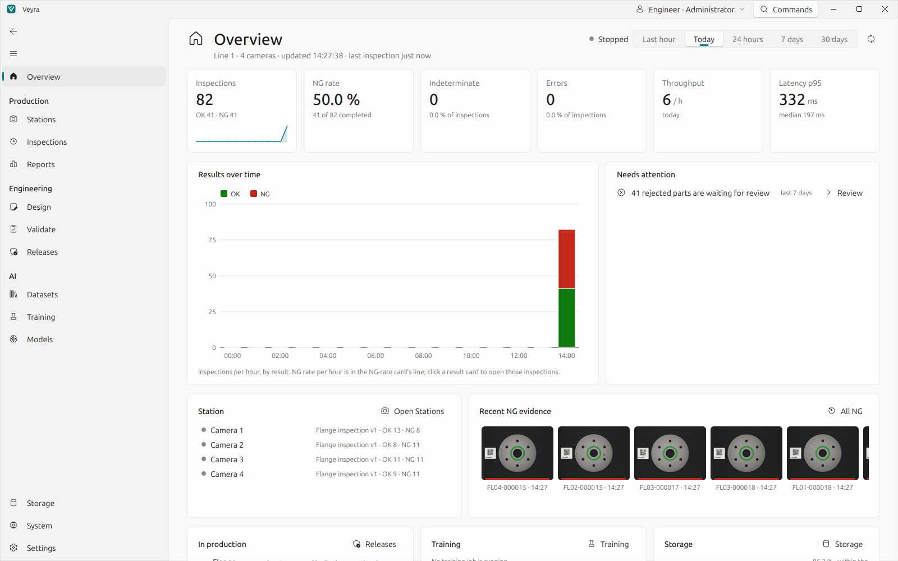

[Status](#product-status) · [What it does](#what-it-does) · [AI models](#ai-models) · [Screens](#screens) ·
[Feature matrix](#feature-and-compatibility-matrix) · [Architecture](#architecture) · [Setup](#installation-and-setup) ·
[Usage](#a-first-inspection) · [Testing](#testing-and-verification) · [Limitations](#known-limitations) ·
[Documentation](#documentation) · [Contents](#what-this-repository-contains) · [Issues](#questions-and-issues) ·
[Licence](#licence-and-third-party-components)

## Product status

| | |
|---|---|
| **Product** | Commercial industrial machine-vision and AI visual-inspection platform |
| **History** | Developed since 2022; continuously maintained, improved and updated |
| **Current release** | 0.3.0 (October 2026); changes in [RELEASE_NOTES.md](RELEASE_NOTES.md) |
| **Platforms** | Windows 10/11 and Linux (X11 or Wayland); standalone Windows build |
| **Verification** | Software tests and model verification on CPU; cameras on simulated and emulated devices and one physical USB camera. GPU training and physical industrial cameras and PLCs are not yet verified (see [verification](docs/verification.md)). |

## What it does

| Workspace | For | What you do there |
|---|---|---|
| **Overview** | everyone | Production at a glance: inspections, NG rate (NG ÷ OK + NG, with its denominator), indeterminate and error results, throughput, latency, against the previous period; what needs attention; every figure opens the inspections behind it. |
| **Stations** | operators, vision engineers | Each camera runs its own released pipeline; live tiles, counters and health; production runs (product, batch, lot); cameras found and tested (OpenCV, Basler pylon, GenICam/GenTL, replay, simulator); station I/O (Modbus TCP or simulated); a pre-start checklist. |
| **Inspections** | quality engineers | A Year → Month → Day → result calendar, filters on every traceability field, the evidence of each inspection with its overlay, compared with an OK part, *why* it was decided, its provenance, and the append-only review and quality-hold history. |
| **Reports** | quality engineers | Period summaries; CSV, JSON, PDF and Excel with every inspection, check and review; evidence packages. |
| **Design**, **Validate**, **Releases** | vision engineers | Build a workflow of 72 tools (classical vision and AI) on sample images as steps or a graph, from templates for common inspections; validate on labelled data; release, benchmark, approve, activate, roll back. |
| **Datasets** | AI and vision engineers | The labelling workspace: boxes, outlines, rotated boxes, keypoints, classes and anomaly references; suggestions from a model reviewed before they count; reviews; YOLO, COCO and DOTA exchange; immutable versions. |
| **Training**, **Models** | AI engineers | Train Veyra's own models, or Ultralytics and Anomalib models in a separate AI environment; every export checked against the framework before it is registered; validate with the task's metrics; approve. |
| **Storage**, **System**, **Settings** | administrators | Retention with preview, journalled cleanup and backups; health checks, events, audit log, diagnostics; users, roles and sign-in; the AI environment and tool models. |

**Results mean one thing.** *OK* and *NG* are completed inspections; *Indeterminate* (no trustworthy decision) and
*Error* (a technical failure, nothing assessed) are counted on their own and never become a pass. Rates are computed
over completed inspections. The original image is never modified, people's reviews never overwrite the machine's
decision, protected evidence is not removed by cleanup, and every result is traceable to the station, camera, pipeline
version, model versions, production run and configuration snapshot that produced it.

## AI models

| Source | Models | Trains in | Runs in production with |
|---|---|---|---|
| **Veyra's own** | Gaussian reference anomaly model; YOLOv1–v11, YOLOX, FCOS and centre-point detectors; compact CNN, ResNet and ViT classifiers | Veyra's trainer process (PyTorch) | ONNX Runtime |
| **Ultralytics 8.4** | YOLOv3u to YOLO26, RT-DETR, YOLO-World, YOLOE: detection, instance segmentation, pose, rotated boxes, classification, semantic segmentation | the AI environment | ONNX Runtime, with Veyra's own decoder of each head |
| **Anomalib 2.7** | PatchCore, PaDiM, EfficientAD, Dinomaly, FastFlow, Reverse Distillation, STFPM and 23 more | the AI environment | ONNX Runtime |

Ultralytics and Anomalib run in an **AI environment**, a Python environment of their own that Veyra probes, sets up on
request and runs worker processes in, so PyTorch, CUDA and Ultralytics' AGPL licence stay out of Veyra's build.
Every export passes a **parity check**: Veyra's runtime must reproduce the framework's own predictions before the model
is registered, with its provenance (framework and PyTorch versions, device, the pretrained weights' SHA-256).

**55 of 60 framework models were verified end to end on CPU** (Ultralytics 27 of 30, Anomalib 28 of 30): trained for a
few epochs on Veyra's synthetic sample sets, exported to ONNX, and reproduced by Veyra's runtime. The five that were not
verified, and why, are listed in [docs/models.md](docs/models.md). These runs prove the training, export and inference
path; they do not measure accuracy on real parts, and none ran on a GPU.

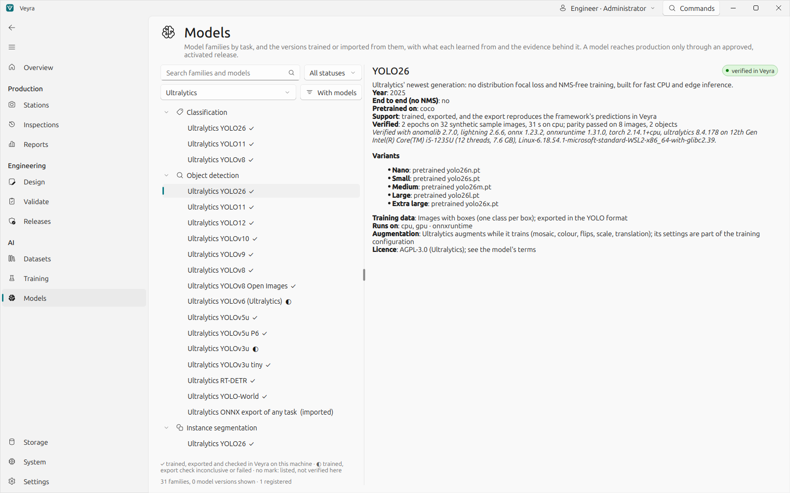

## Labelling and vision tools

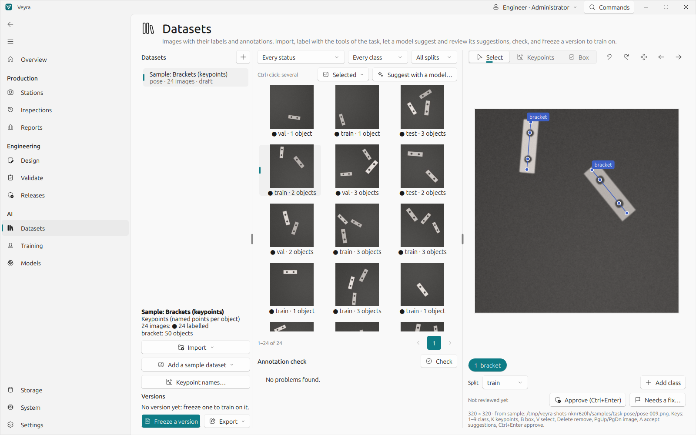

The labelling tools follow the task (boxes, outlines, rotated boxes, keypoints with a schema, image classes, anomaly
references and defect regions). A model's suggestions are drawn hatched and become annotations only when a person
accepts them. See [docs/datasets.md](docs/datasets.md).

The 72 vision tools in 18 categories cover contrast and flat-field correction, thresholds by brightness and colour,
morphology, watershed separation, blobs and shape measurement, edges, calipers, line and circle finding, pattern
matching, alignment (features with RANSAC, phase correlation, ECC) with regions that follow the part, comparison with a
golden part, colour ΔE, Data Matrix, QR, PDF417, Aztec and barcodes, OCR with fielding, lens undistortion, AI tools for
every task and logic and checks. Every tool keeps the way back to the original frame, so results land on the camera
image in calibrated units. Catalogue and measured accuracy: [docs/vision-tools.md](docs/vision-tools.md).

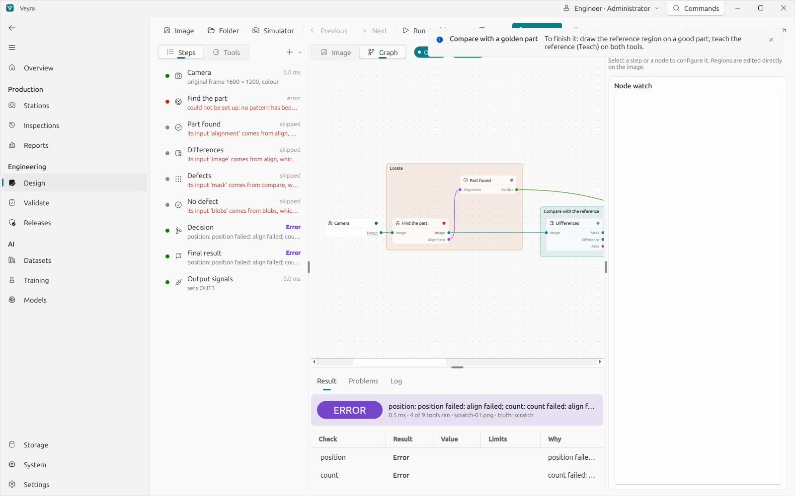

## Screens

Every screenshot is the real application, captured from a fresh data folder. Nothing is mocked. The cameras are
simulated and the screens say so; the parts are generated by Veyra itself.

| | |
|---|---|
| 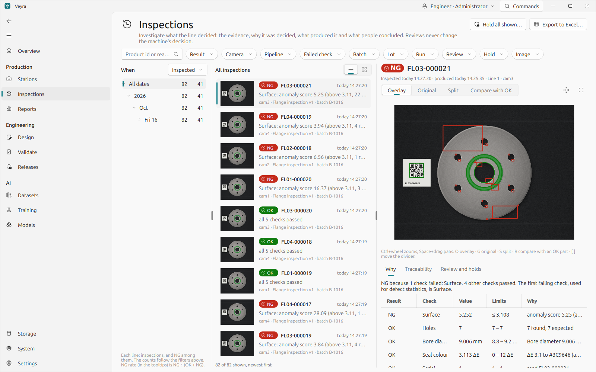 | 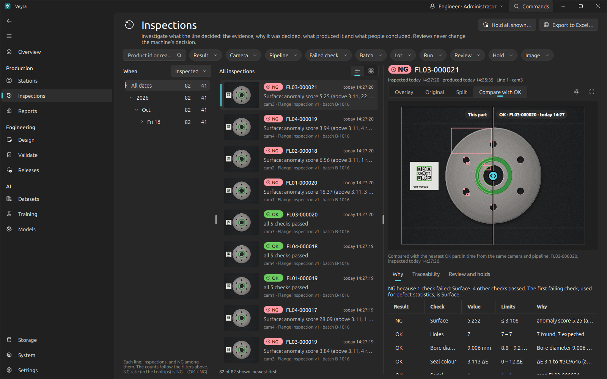 |
| **Inspections:** the calendar, the inspections of the selection, and an NG part's evidence: the defect marked, and why. | **Compare with OK:** the rejected part beside the nearest OK part from the same camera. |
| 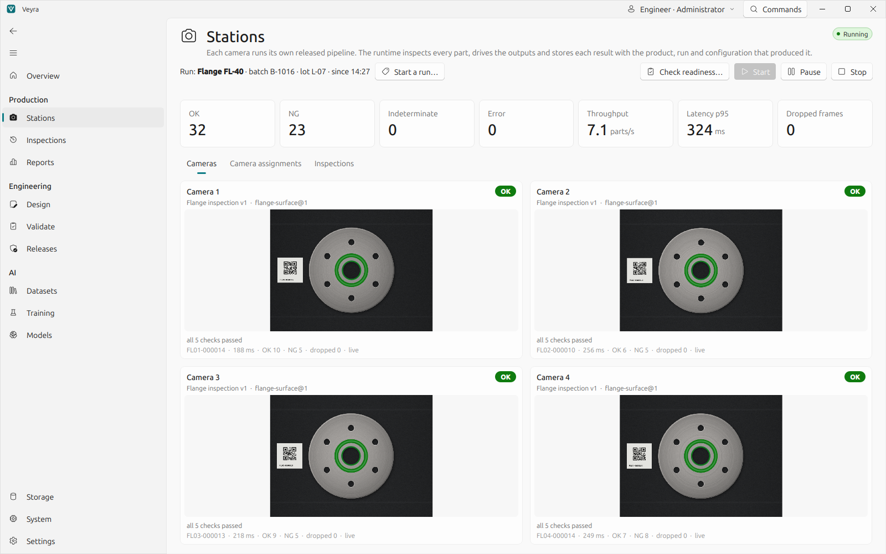 | 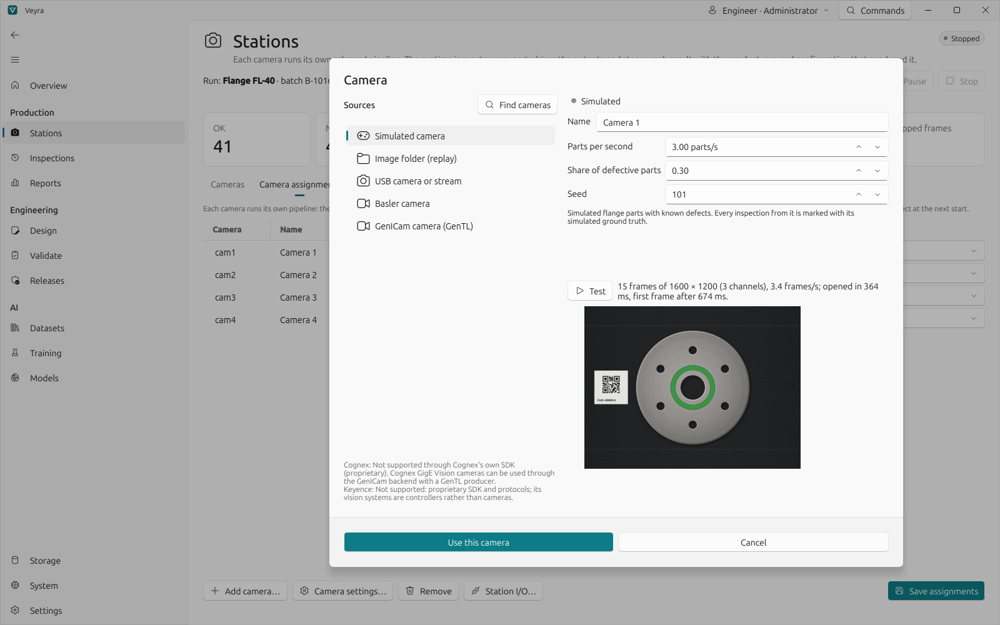 |
| **Stations:** four cameras inspecting, each with its pipeline version, result and counters. | **Camera:** every kind of source with how far it was verified; *Test* shows a real frame and the measured frame rate. |
| 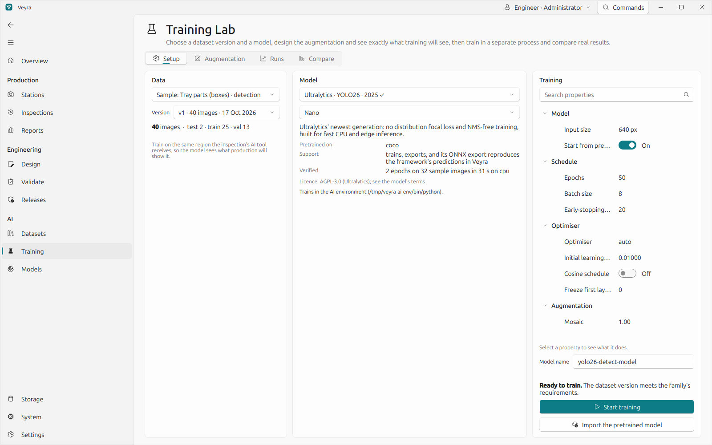 | 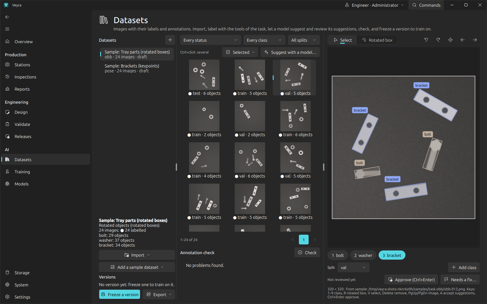 |
| **Training:** an Ultralytics YOLO26 run set up on a frozen dataset version, with its verification and licence. | **Rotated boxes:** bolts, washers and brackets at any angle. |
| 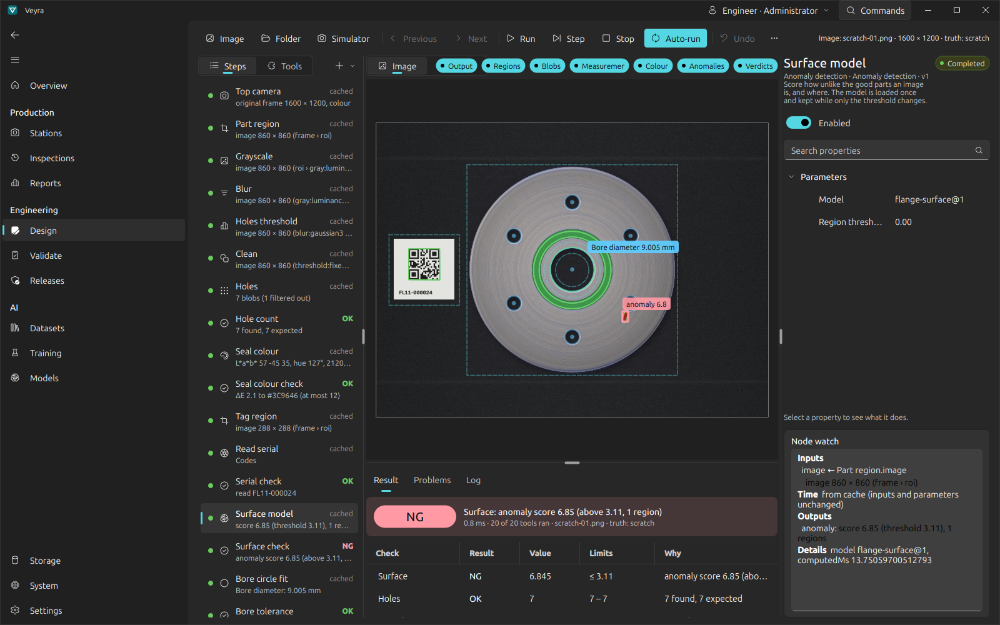 | 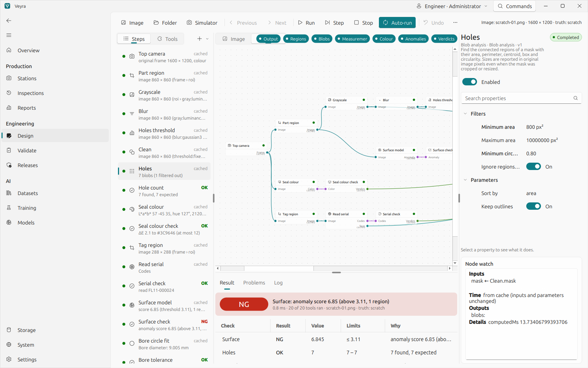 |
| **Design:** the sample flange inspection on a scratched part. | **Graph:** the same workflow as typed nodes and links. |
| 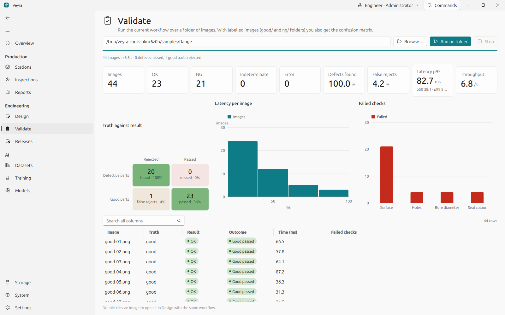 | 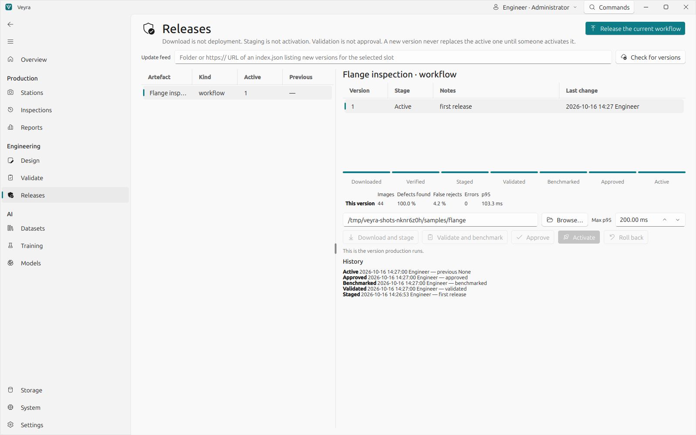 |
| **Validate:** a labelled folder with the confusion matrix, latency and failed checks. | **Releases:** staged, validated, benchmarked, approved and active, with history. |
| 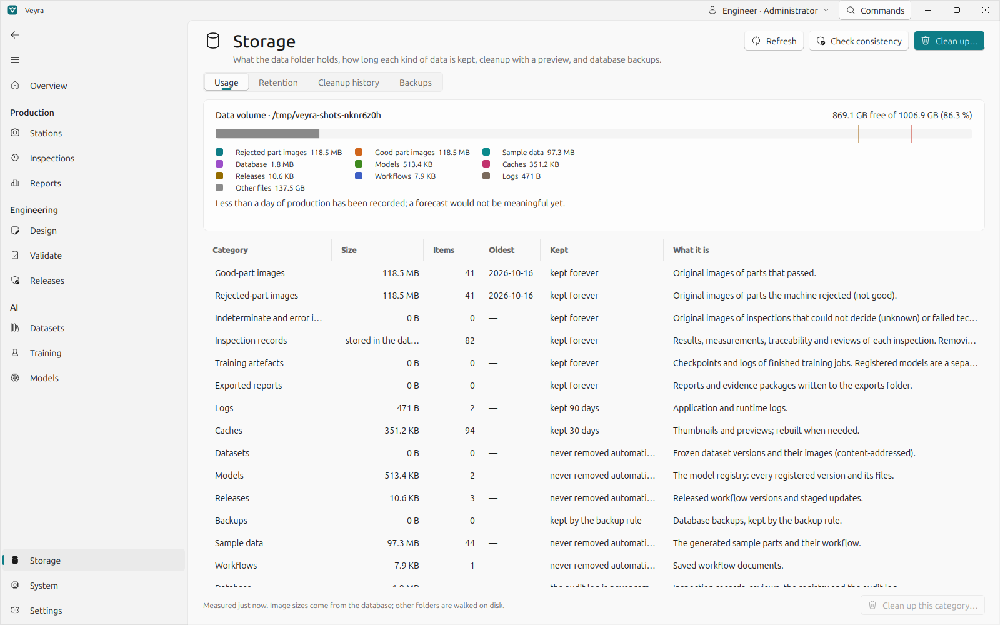 | 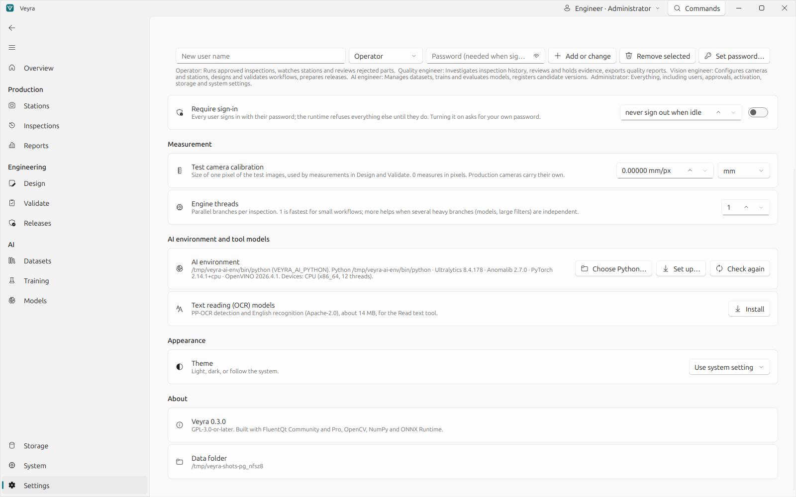 |
| **Storage:** the data volume by category, growth, and what each rule keeps. | **Settings:** the AI environment, what it can do, and the OCR models. |

The other theme of every screen is in [`docs/images`](docs/images).

## Feature and compatibility matrix

✅ implemented and verified as described · 🟡 implemented, verified only on simulated or emulated devices or
partially · ⬜ implemented, not verified on the named hardware · ✖ not implemented

| Area | Capability | Status | Evidence |
|---|---|---|---|
| Inspection | Typed workflows of 72 tools, incremental re-runs, steps and graph editors, templates | ✅ | automated tests |
| Inspection | Releases with validation, benchmark, approval, activation and rollback | ✅ | automated tests |
| Inspection | Evidence, reviews, quality holds, reports, Excel export, retention, backups | ✅ | automated tests; storage benchmark at 500,000 inspections |
| AI | Veyra's own anomaly, detection and classification models (CPU) | ✅ | automated tests against reference decoders |
| AI | Ultralytics training, import, ONNX export with parity check (CPU) | ✅ 27 of 30 models | [models.md](docs/models.md) |
| AI | Anomalib training, ONNX export with parity check (CPU) | ✅ 28 of 30 models | [models.md](docs/models.md) |
| AI | Training on an NVIDIA GPU (CUDA) in the AI environment | ⬜ | no GPU on the reference machine |
| AI | GPU inference in production | ✖ | production uses ONNX Runtime's CPU provider |
| AI | Interactive segmentation (SAM) in labelling; video anomaly models | ✖ | |
| Labelling | Boxes, outlines, rotated boxes, keypoints, classes, anomaly references; suggestions with review; YOLO, COCO, DOTA | ✅ | automated tests |
| Labelling | Semantic-segmentation masks; video | ✖ | |
| Cameras | Simulated camera, image-folder replay | ✅ | automated tests |
| Cameras | USB (UVC) cameras and streams through OpenCV | ✅ | a laptop's built-in UVC camera on Windows 11 |
| Cameras | Basler cameras through pylon | 🟡 | pylon's camera emulator; no physical Basler camera yet |
| Cameras | GenICam / GenTL cameras of other makers | 🟡 | simulated GenTL producer; no physical camera yet |
| Cameras | Cognex and Keyence SDKs | ✖ | their GigE Vision cameras would go through GenICam (not verified) |
| I/O | Modbus TCP station I/O | 🟡 | an independent Modbus implementation; no physical PLC yet |
| I/O | Modbus RTU, OPC UA | ✖ | |
| Platform | Studio and runtime on Windows and Linux; standalone Windows build verified by a smoke test | ✅ | |
| Platform | Installer, signed updates, macOS | ✖ | |

## Architecture

```
Veyra studio (FluentQt)                          Veyra runtime (child process, or headless)
  pages, documents, undo     ──── JSON + raw pixels ──►  session: one command module per domain, permissions
  draws results & previews   ◄── over stdin/stdout ──   station: cameras → bounded queues → workers → I/O, storage
                                                         engine: typed graph, bounded thread pool
                                                         tools: OpenCV vision, ONNX Runtime models, OCR, codes
                                                         store: SQLite (migrations), evidence folder, audit log
  trainer process  ── Veyra's own models (PyTorch) ──    AI environment (another Python): Ultralytics, Anomalib
                   ── JSON lines ──────────────────►      workers: train, export, reference predictions
```

The workflow engine has no Qt and no OpenCV; the studio never imports OpenCV or ONNX Runtime; training runs in its own
process, the frameworks in their own environment. The design and the reasons for it are in
[docs/architecture.md](docs/architecture.md).

**Performance** on an Intel Core i5-1235U laptop, CPU only ([method](docs/performance.md)): the sample inspection of
17 tools including the ONNX anomaly model on a 1600 × 1200 image runs at p50 16.7 ms, p95 26 ms; the newest page of
the inspection list among 500,000 stored inspections opens in 1 ms; Excel export writes 2,880 inspections/s. These
numbers describe that machine and those workloads only.

## Installation and setup

Veyra is delivered as a standalone Windows folder (one executable that is the studio, the runtime and the trainer),
built with Nuitka and verified by running it. PyTorch, Ultralytics, Anomalib, camera SDKs and model weights are not
bundled: they are installed by the user, and Veyra explains what is missing.

| | |
|---|---|
| **Operating system** | Windows 10/11 or Linux (X11 or Wayland). |
| **Hardware** | A PC; nothing else is needed to try it: a simulated camera, a folder of images and the simulated I/O module stand in for cameras and a PLC. |
| **Cameras (optional)** | USB/UVC cameras work through OpenCV. Basler cameras need Basler's pylon runtime (`pypylon`); GenICam cameras need their vendor's GenTL producer and `harvesters`. |
| **AI environment (optional)** | For Ultralytics and Anomalib: any Python 3.10–3.13. **Settings → AI environment → Set up…** creates one, or use an existing one. |
| **Data** | Per user: `%LOCALAPPDATA%\Veyra`, `~/.local/share/Veyra` or `~/Library/Application Support/Veyra`; `VEYRA_HOME` overrides it. |

The AI environment can also be prepared by hand (pick the PyTorch build for your CUDA version, or CPU):

```bash
python -m venv ai-env
ai-env/bin/python -m pip install torch torchvision --index-url https://download.pytorch.org/whl/cpu   # or cu126, cu128…
ai-env/bin/python -m pip install ultralytics anomalib onnx onnxscript onnxslim onnxruntime
```

Ultralytics' code and weights are AGPL-3.0 and pretrained weights carry their training data's terms; check them before
shipping a model ([models.md](docs/models.md#licences-to-check-before-shipping-a-model)).

## A first inspection

1. **Overview → Open the sample line.** The runtime generates 44 labelled parts of a simulated machined flange, trains
   the anomaly model on 16 good parts and validates it, in a few seconds.
2. **Design** opens the flange workflow: holes counted and the bore measured in millimetres, the seal colour, the serial
   read from the QR code, the anomaly model on the surface, and a decision. Or start from a template (*Ctrl+Shift+N*).
3. **Validate** runs the labelled folder; **Models → Approve**; **Releases → Release → Validate and benchmark →
   Approve → Activate**.
4. **Stations → Add camera…**: the simulated camera, a folder, a USB or GenICam camera; **Test**; choose the pipeline;
   **Save**; **Check readiness…**; **Start**.
5. **Inspections**: pick a day and *NG*, open a part, compare it with an OK part, and record your review.
6. **Datasets → Add a sample dataset → Tray parts: boxes**, freeze it, then **Training**: choose Ultralytics YOLO26 and
   train (with an AI environment set up), or **Import the pretrained model**.

The same executable runs headless:

```bash
Veyra.exe run WORKFLOW.json --image part.png --mm-per-pixel 0.05     # one inspection, JSON out, exit code 1 if not OK
Veyra.exe run WORKFLOW.json --folder dataset/ --quiet                # a batch: counts, confusion matrix, latency
Veyra.exe run WORKFLOW.json --simulate 200                           # 200 parts from the simulated camera
Veyra.exe simulate samples/                                          # write the labelled sample set
```

Day-to-day operation, storage, backups and sign-in: [docs/operations.md](docs/operations.md).

## Testing and verification

The test suite lives with the private source. For release 0.3.0 it was run on the reference laptop (Core i5-1235U,
no NVIDIA GPU) on 2026-10-17: **197 passed and 2 skipped on Linux** with real Ultralytics and Anomalib training and the
OCR models, and the **2 skipped Windows-only tests passed on Windows**. It covers the workflow engine, vision tools
against generated ground truth, detectors against reference decoders, the runtime protocol, storage, reports, roles,
cameras on simulated and emulated devices, Modbus TCP against an independent implementation, and every studio page.

The 55-of-60 model verification and the Windows standalone build smoke test were recorded on 2026-10-16. What ran on
CPU, on emulated or simulated devices and on real hardware, and the hardware checks still open, are listed in
**[docs/verification.md](docs/verification.md)**.

## Known limitations

- **Not verified on a GPU.** Training runs on CUDA through the AI environment's PyTorch, but no run on an NVIDIA GPU
  has been recorded; production inference uses ONNX Runtime's CPU provider.
- **Industrial cameras and PLCs** are verified on emulated and simulated devices only (pylon's emulator, a simulated
  GenTL producer, an independent Modbus implementation). The one physical camera verified is a laptop's UVC camera.
- **Five framework models are not verified**: YOLO26 semantic segmentation, YOLOv3u and YOLOv6 (parity inconclusive),
  SuperADD (killed for lack of memory with the 7.6 GB available to the reference machine's Linux environment), AnomalyVFM (no ONNX export).
- **Model verification is a path check**, not an accuracy claim: every model trained a few epochs on synthetic sample
  sets.
- **Not implemented**: Cognex and Keyence SDKs, Modbus RTU, OPC UA, SAM-assisted labelling, semantic-segmentation
  masks and video in labelling, directory services, scheduled reports, an installer, signed updates, macOS.
- **OCR** was measured on generated markings; real markings need their own samples.

## Documentation

- [Architecture](docs/architecture.md): the design and why it is so.
- [AI models](docs/models.md): the AI environment, training, the parity check, per-model results and licences.
- [Vision tools](docs/vision-tools.md): every tool, alignment, measurement, codes and OCR with measured accuracy.
- [Datasets and labelling](docs/datasets.md): tasks, tools, suggestions, reviews, formats, the sample data.
- [Cameras](docs/cameras.md) and [running a station](docs/operations.md): backends, I/O, storage, backups, sign-in.
- [Verification](docs/verification.md): the tests, what they ran on, and the hardware checks still open.
- [Performance](docs/performance.md) and [release notes](RELEASE_NOTES.md).

## What this repository contains

| Published here | Kept in the private repository |
|---|---|
| This overview, the product documentation, the verification record, release notes, third-party notices | Source code of the studio, runtime, trainer, vision tools, model adapters and AI-environment workers |
| 38 screenshots of the real application (light and dark) with generated sample parts | The test suite, benchmarks, packaging and screenshot scripts, development history |
| | FluentQt Community and Pro (separate private products) |

No model weights, datasets, customer images or credentials are part of either the published documentation or its
history. Every image shown was generated by Veyra itself.

## Questions and issues

Questions about the documentation, corrections and feature requests are welcome as
[GitHub issues](https://github.com/pntrungbk15/veyra-showcase/issues). Please do not attach production images,
customer data or anything confidential. For a security concern, open an issue that only asks for a private contact,
without details.

## Licence and third-party components

The documentation and screenshots in this repository are © Phạm Ngọc Trung and are not offered under an open-source
licence; they may be viewed and linked to. Veyra is not distributed from this repository. The third-party components
Veyra uses, what is installed by the user and what is downloaded on request are listed with their licences in
[THIRD_PARTY_NOTICES.md](THIRD_PARTY_NOTICES.md). Product names and trademarks belong to their owners.
